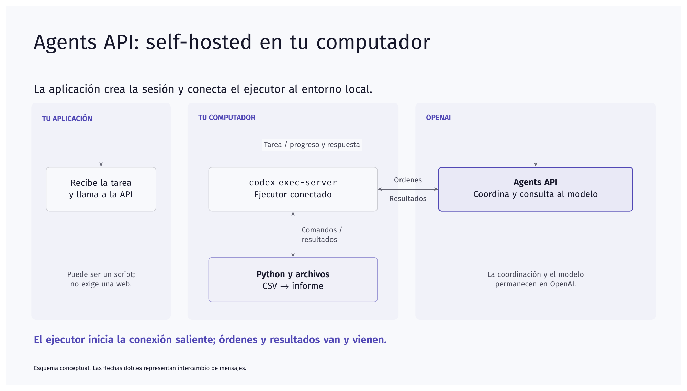
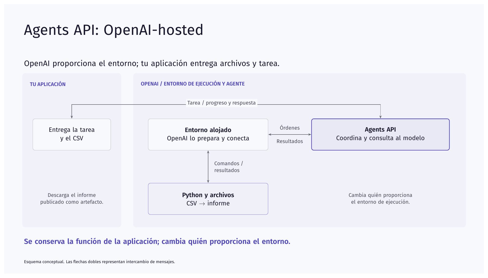
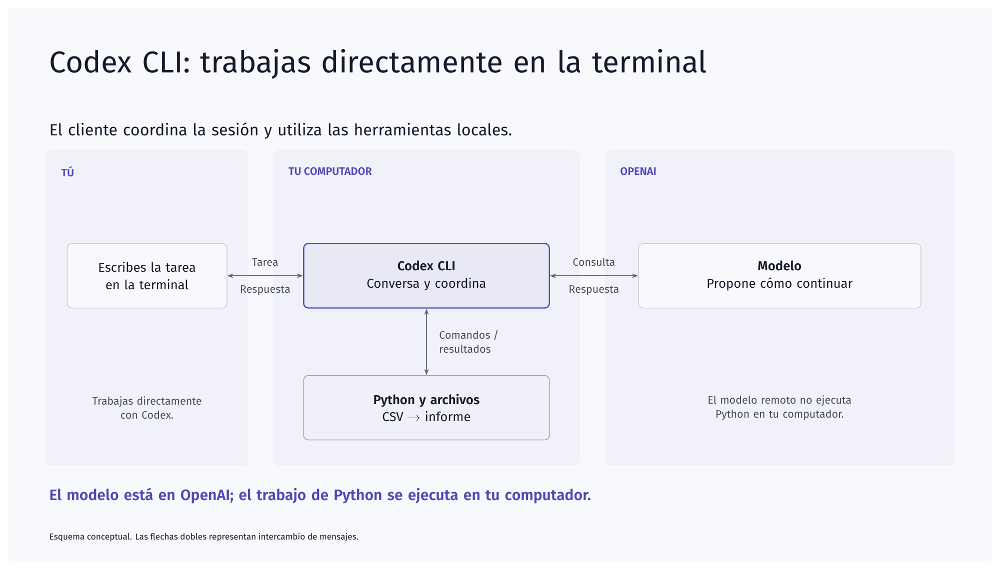

# Entorno, coordinación y ejecutor: una tarea paso a paso

Guía conceptual · Revisada el 17 de noviembre de 2026

**El modelo, el programa que coordina al agente y el entorno que ejecuta Python
son piezas distintas.** Sigamos una tarea: leer `importes.csv` y generar un informe.
Las figuras explican recorridos; no documentan ejecuciones nuevas.

## 1. Primero: quién hace cada parte

| Función | Qué hace | Ejemplo |
|---|---|---|
| Aplicación | Recibe y entrega una tarea. Puede ser un script. | «Resume este CSV y guarda el informe». |
| Coordinación del agente | Consulta al modelo y usa herramientas para continuar. | Leer, calcular y comprobar. |
| Modelo | Propone cómo resolver la tarea. | Escribir el código necesario. |
| Herramientas en el entorno | Ejecutan las operaciones sobre procesos y archivos. | Python lee el CSV y guarda JSON. |

En Agents API, OpenAI mantiene la coordinación. El entorno de ejecución puede
ser propio o proporcionado por OpenAI. [Arquitectura](https://developers.openai.com/api/docs/guides/agents-api/architecture).

## 2. Self-hosted en tu computador

Tú preparas el entorno y sus controles. La aplicación crea una sesión y el
programa `codex exec-server` la conecta al computador. Después se entrega la tarea.



El ejecutor inicia la conexión saliente WebSocket. Las flechas muestran mensajes
que van y vienen, no que OpenAI abra una conexión entrante. El modelo sigue en
OpenAI y recibe resultados de herramientas; self-hosted no significa que todo
el procesamiento permanezca local. [Guía self-hosted](https://developers.openai.com/api/docs/guides/agents-api/environments/self-hosted).

Al completar la tarea se recoge y verifica el informe local, se cierra la sesión
y se detiene el ejecutor. Una carpeta de trabajo por sí sola no demuestra aislamiento.

## 3. OpenAI-hosted

Tu aplicación solicita el entorno y aporta el archivo y la configuración. OpenAI
lo prepara y conecta; la aplicación envía la tarea cuando esté listo.



El informe publicado desde `/workspace/outputs` se descarga como artefacto.
Se conserva y verifica antes de eliminar la sesión. La aplicación no necesita
preparar un computador ejecutor propio. [Guía alojada](https://developers.openai.com/api/docs/guides/agents-api/environments/openai-hosted),
[archivos y artefactos](https://developers.openai.com/api/docs/guides/agents-api/environments/files).

## 4. ¿Y abrir Codex en la terminal?

Ejecutar `codex` permite conversar directamente y trabajar sobre el proyecto.
El cliente coordina el trabajo, consultando al modelo, y utiliza herramientas locales.



En cambio, con `exec-server` la tarea llega a Agents API desde tu aplicación.
El proceso local actúa como ejecutor de las herramientas solicitadas por esa sesión.
[Codex CLI](https://learn.chatgpt.com/docs/codex/cli).

| Necesidad | Comando o modalidad |
|---|---|
| Conversar y trabajar en la terminal. | `codex` |
| Lanzar una tarea de Codex desde un script. | `codex exec` |
| Conectar tu entorno a una sesión de Agents API. | `codex exec-server` en self-hosted |
| Pedir a OpenAI el entorno de ejecución de Agents API. | OpenAI-hosted |

`codex exec` es el modo no interactivo del cliente, no otro nombre del ejecutor.
[Modo no interactivo](https://learn.chatgpt.com/docs/non-interactive-mode).

## 5. Límites y revisión

El sandbox aplica controles a la ejecución. Una aprobación revisa una acción
que requiere autorización adicional. Son conceptos diferentes del lugar donde
está el entorno. Leer [permisos de Codex](permisos-codex.md) para ejemplos.

Para saber si el informe es correcto, se abren sus archivos y se contrastan con
la referencia. El éxito del cálculo no prueba aislamiento completo.

## 6. Dónde encaja OCI

OCI es otra infraestructura posible para self-hosted. El ejemplo
[application-managed del Cookbook](https://github.com/openai/openai-cookbook/tree/main/examples/agents_api/sandboxes/oci/application_managed)
explica cómo una aplicación gestiona el ciclo del entorno. Se conserva como
extensión en [pendientes](../../PENDIENTES.md); no hace falta para entender la
comparación entre tu computador y OpenAI.

## Figuras y reproducción

[PDF de las tres figuras](output/pdf/diagramas.pdf) · [Fuente LaTeX](diagramas.tex) ·
[Fuentes y decisiones de diseño](fuentes-y-diseno.md).

Los diagramas comparten fuentes TikZ con la [presentación única](../../presentation/openai-y-sandbox/README.md).
Las imágenes PNG permiten leer esta guía sin soporte Mermaid.

Desde la raíz:

```bash
python3 docs/codex-vs-exec-server/compilar.py
```

Requiere LuaLaTeX, TikZ, standalone, fontspec, Fira Sans/Mono y Poppler.
La compilación verifica tres páginas y caracteres/desbordamientos; los
intermedios quedan en `build/`, ignorado por Git. Revisar visualmente al editar.
